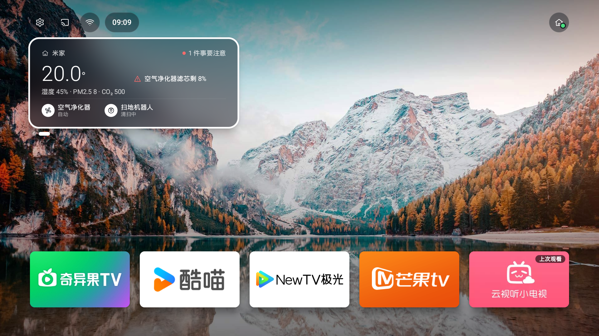
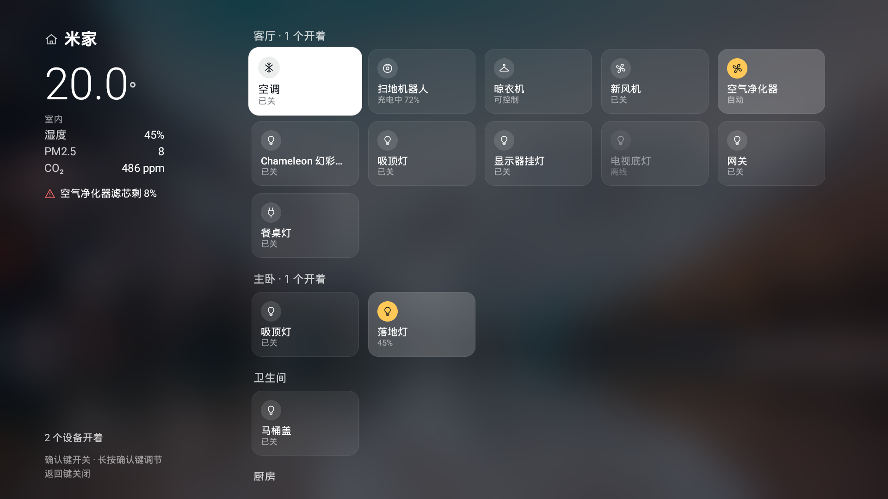
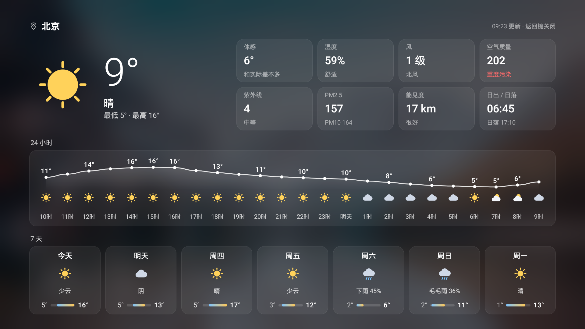

# 家里桌面（TvHome）

替换电视自带首页的 Android TV 桌面。打开电视就能看到天气、3D 打印机、米家设备状态，常用的影视 App 一键进入。





## 功能

**首页**
- 顶栏：左边设置、手机投屏、网络、时间；右边 Mac mini、3D 打印机、米家三个状态点（绿=正常，黄=打印中，红=断开），选中时展开显示文字
- 左上角信息卡：天气 / 3D 打印机 / 米家三页，遥控器左右翻页，按确认键进入对应的全屏页
- 点播行：已安装的影视 App 用 16:9 横幅排一行，上次打开的那个带「上次观看」角标
- 已经在桌面时再按 HOME 键，回到首页初始状态

**米家全屏页**
- 左边是室内温度、湿度、PM2.5、CO₂ 和需要注意的提醒（如滤芯快用完）
- 右边按房间列出所有设备，确认键开关，长按确认键调节（亮度、温度、风速等）
- 控制需要接 Home Assistant；只接设备桥时只能看状态

**天气全屏页**
- 当前温度、体感、湿度、风、空气质量、紫外线、PM2.5、能见度、日出日落
- 未来 24 小时温度曲线和 7 天预报

**全部应用**（在点播行按「下」打开）
- 常用（已连接的 HDMI 设备 + 自己加的应用）、直播、全部应用三组
- 长按确认键或按菜单键：打开 / 加到或移出「常用」/ 应用信息

**手机投屏**
- 顶栏「手机投屏」弹出二维码，iPhone 相机扫码用 Safari 打开，选照片或视频后电视全屏播放，手机上能暂停、继续、停止。iPhone 不用装 App

**设置页**

| 分类 | 能改什么 |
|------|----------|
| 系统设置 | 跳到电视自带的系统设置（顶栏齿轮长按也能直接进） |
| 壁纸 | 自带壁纸 / 必应每日壁纸 / 必应近 8 天任选一张 / 手机上传照片 |
| 天气 | 城市 |
| 家里设备 | Home Assistant 地址和令牌、要显示的设备；或设备桥地址 |
| 手机 / 电脑设置 | 在浏览器打开 `http://<电视IP>:8686`，输入电视上显示的 6 位配对码后改设置。长令牌建议在这里填 |

## 先决条件

| 项 | 要求 |
|----|------|
| 电视 | 原生 Android TV（索尼 / 雷鸟 / TCL 等），Android 7.0 及以上 |
| 3D 打印机状态（可选） | Mac mini 上跑着 PrintPilot 后端 |
| 米家（可选，二选一） | Home Assistant + xiaomi_miot 集成（能看能控）；或 Mac mini 上跑 `tools/mijia-bridge`（只支持 Yeelight 灯） |
| 网络 | 电视和上述设备在同一个局域网 |

## 编译和安装

```bash
./gradlew assembleDebug
# 产物：app/build/outputs/apk/debug/app-debug.apk

adb connect <电视IP>:5555      # 电视先开「开发者选项 → 网络调试」
./tools/install.sh             # 装过一次之后，改完再跑约 3 秒
```

装好后按遥控器 Home 键，在弹出的选择框里选「家里桌面」并勾「始终」。没弹框的话：设置 → 应用 → 默认应用 → 主屏幕 → 选择「家里桌面」。

## 预览方式

| 方式 | 怎么做 | 适合 |
|------|--------|------|
| Mac 上跑电视模拟器 | `./tools/run-tv-emulator.sh`，打开一台 1080p 安卓电视 | 想在电脑上自己点 |
| Android Studio 静态预览 | 打开 `app/src/main/java/com/zlaong/tvhome/ui/Previews.kt`，右上角切到 Split | 改样式时 |
| 真机截图 | `adb exec-out screencap -p > screen.png`（电视要先唤醒，不然是黑屏） | 看真实效果 |

## 首次配置

顶栏齿轮进「设置」：
- 天气：填城市（例 `杭州`）
- 家里设备：填 Home Assistant 地址和长期访问令牌（在 Home Assistant 头像 →「安全」里创建），再勾要显示的设备
- 没有 Home Assistant 时，填设备桥地址；留空则用 Mac mini 的 IP + `:8080`

## 数据来源

| 数据 | 来源 | 刷新 |
|------|------|------|
| 天气 | `api.open-meteo.com`，免费无 Key | 定时 |
| 3D 打印机 | `http://<Mac mini>:3000/api/status`，只读；Mac mini 状态点也看这个接口通不通 | 每 3 秒 |
| 米家（Home Assistant） | Home Assistant 的 `/api/states`，令牌只存在电视上 | 定时 |
| 米家（设备桥） | `http://<设备桥>:8080/api/home` | 每 10 秒 |
| HDMI 设备 | 系统的电视输入列表，只显示插着且开机的口 | 打开时 |
| 壁纸 | 自带《星空下的雪山》（[Unsplash](https://unsplash.com/photos/1519681393784-d120267933ba)，Unsplash License）或 `cn.bing.com` 每日壁纸 | 每天 |

## 目录

| 路径 | 内容 |
|------|------|
| `app/` | 电视桌面 App（Kotlin + Jetpack Compose） |
| `tools/install.sh` | 编译并热装到电视 |
| `tools/run-tv-emulator.sh` | 启动 Android TV 模拟器 |
| `tools/mijia-bridge/` | 局域网 Yeelight 设备桥（Node.js，`node server.js` 启动） |
| `docs/` | 截图和设计稿 |

## 下一步可做

- 打印机控制（暂停 / 继续 / 取消），需要给 PrintPilot 后端加下发通道
